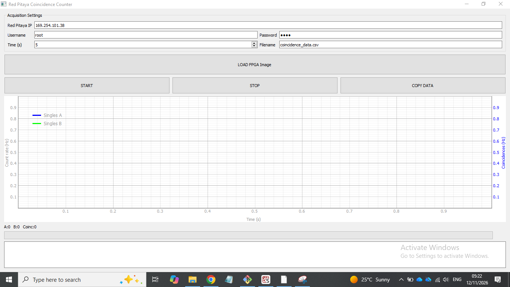

# Single Photons Coincidence Counter with RedPitaya

Two-channel coincidence counter for single-photon experiments, such as
measuring photon pairs produced by spontaneous parametric down-conversion
(SPDC), built on the Red Pitaya STEMlab 125-14. An FPGA design counts pulses
from two detectors and the coincidences between them (80 ns window). A Python
GUI loads the design onto the board, plots live count rates, and saves the
data as a CSV file.



## How it works

- **FPGA design** (`fpga/`): runs at 125 MHz (8 ns per tick). Each input is
  synchronised and edge-detected. Counters for channel A, channel B and
  coincidences are exposed as registers. Two events on different channels
  within 10 ticks (80 ns) count as a coincidence.
- **Acquisition script** (`software/coincidence_read_v2.py`): runs *on the Red
  Pitaya*. It reads the counters about every 0.25 s, converts count differences
  to rates in Hz (handling 32-bit rollover), prints them, and saves a CSV file.
- **GUI** (`software/coincidence_read_GUI_v5.py`): runs on your PC. Over SSH it
  loads the FPGA bitstream, starts the script, plots singles A, singles B and
  coincidences live, and copies the CSV file back to your PC.

## Requirements

- Red Pitaya **STEMlab 125-14, original generation** (Zynq 7010), running
  **Red Pitaya OS 2.00**, connected to your PC over the network.
  The bitstream is built for this model only.
- Python 3 on your PC, with the packages in `requirements.txt`.
- Developed and tested with the setup above, using Python on Windows.

## Quick start

1. Download this repository (green **Code** button, then **Download ZIP**) or
   clone it with Git.
2. Install the Python packages: `pip install -r requirements.txt`
3. **Copy the acquisition script to the Red Pitaya** (once per board):
   `scp software/coincidence_read_v2.py root@<RED-PITAYA-IP>:/root/`
4. Connect your detectors. **Read [docs/wiring.md](docs/wiring.md) first.**
   The inputs are 3.3 V only.
5. Start the GUI: `python software/coincidence_read_GUI_v5.py`
6. Enter the board's IP address (or hostname), username and password in the
   window. The defaults are the Red Pitaya factory login, `root` / `root`.
   Change the password on any shared network.
7. Press **LOAD FPGA IMAGE** and wait for "Coincidence FPGA loaded
   successfully." Repeat this after every Red Pitaya restart.
8. Enter the acquisition time and a filename, then press **START**.
9. When the run has finished, press **COPY DATA**. The CSV file is saved in
   the folder you launched the GUI from.
10. When you are done, restart the Red Pitaya to return to its standard apps.

**Notes**
- **STOP** aborts the run and **no CSV file is written**. COPY DATA would then
  fetch an older file with the same name, so use a new filename for each run.
- The GUI accepts the board's SSH host key automatically. Use it on trusted
  networks only.

## Output format

```
Time_s,Coincidence_rate_Hz,Singles_A_rate_Hz,Singles_B_rate_Hz
```

One row about every 0.25 s.

## Wiring and safety

Channel A is DIO0_P and channel B is DIO1_P on the E1 connector. The inputs
are **3.3 V logic only**. See [docs/wiring.md](docs/wiring.md).

## FPGA design

The bitstream in `bitstream/` was generated from `fpga/red_pitaya_coincidence.sv`.
See [docs/fpga_design.md](docs/fpga_design.md) for how it was built, how the
module is connected in Red Pitaya's top-level file, and the register map.

## Accuracy notes

- Timing is in 8 ns steps, so the 80 ns window is accurate to about ±8 ns.
- At high count rates, one event can pair with more than one event on the
  other channel inside the window, so the coincidence count can read slightly
  high.
- Accidental coincidences are about 2 × 80 ns × rate A × rate B. Compare this
  with the measured coincidence rate to judge whether your coincidences are real.

## Credits and license

- Author: [Ali Akbar]
- My code (FPGA module and Python scripts) is released under the MIT license,
  see [LICENSE](LICENSE).
- The FPGA bitstream was built from the official Red Pitaya FPGA project
  (<https://github.com/RedPitaya/RedPitaya-FPGA>), which is under a BSD
  license. See [THIRD_PARTY_NOTICES.md](THIRD_PARTY_NOTICES.md).
- This project is not affiliated with or endorsed by Red Pitaya d.o.o.
